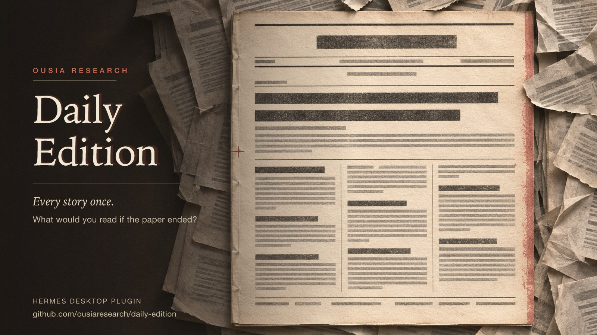
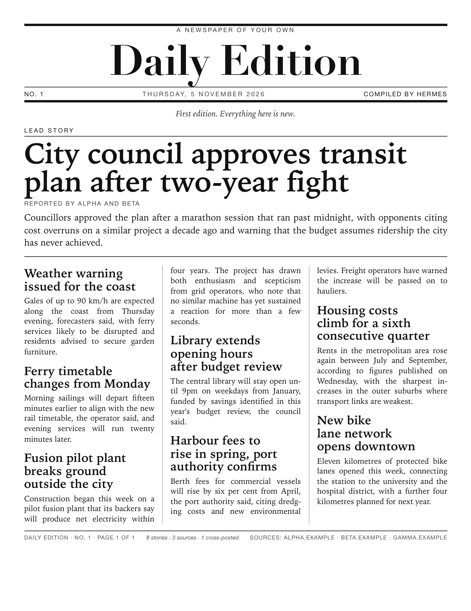

# Daily Edition

[](https://github.com/ousiaresearch/daily-edition/actions/workflows/ci.yml)



A personal newspaper inside Hermes Desktop. **You give it interests, not subscriptions**: name what you care about — a subject, a place, an institution — and it compiles a dated edition with a lead story, one section per interest, cross-source consensus and a shelf of back issues. Stories open and read **inside the paper**; the publisher's page is always one click away. There are no accounts, tracking, or default feeds.

**No model is involved unless you ask for one.** The edition itself is composed deterministically. **Editorial voices** are an opt-in extra: pick a persona and press *Style as ...* to have the headlines rewritten in that voice, always printed above the publisher's own wording.

## Interests, not sources

An interest is a phrase: `fusion energy`, `housing in Málaga`, `the port authority`. Each one is expanded into its own query feed, fetched when the page opens or you print a new edition, and becomes that interest's section. Add up to thirty.

What that buys you, and what it costs:

- **No feed hunting.** You do not need to know that a paper publishes at `/rss/index.xml`; you say what you want to read about.
- **Consensus still works.** A story carried by three mastheads is one article crediting all three, whichever interests surfaced it. Sections are interests; bylines are publishers.
- **The query leaves your machine.** Interest phrases are sent to the news provider when the edition is compiled. That is the trade for not maintaining a source list.
- **The default provider is Google News RSS**, which is public and keyless but whose terms restrict the feed to *personal, non-commercial* use in a reader. Treat that as a personal-use default, not a licence to redistribute its results; swapping the provider is one constant in `dashboard/topics.py`. Plain feeds and OPML import remain available under **Advanced** if you need sources the query feed does not cover.

## What makes this an edition, not a feed

A feed scrolls forever; a newspaper is finished and dated. Each **Print new edition** composes one front page from every source and files it:

- **One story, once.** The same story arriving from three outlets is clustered by canonical link, then by headline evidence: shared wording, a shared named thing ("transit plan") with a compatible verb, or one headline contained in the other. A different year or a contradictory verb — *approved* against *delayed* — keeps two filings apart, and one masthead never cross-posts itself. Clusters are merged transitively, so a story told three ways becomes one article crediting each source (`Alpha · Beta — cross-posted`).
- **A lead.** Consensus wins the top of the page: a story carried by more sources outranks a single-source one, then recency breaks the tie.
- **Sections.** The rest is grouped by the source that carried it, so a page has structure instead of one undifferentiated list.
- **No reprints.** The most recent edition from an *earlier day* is remembered by link and headline, and any story it already carried is withheld rather than printed twice. Re-printing on the same day replaces that day's front page instead of yielding to it.
- **Back issues.** The last seven editions are kept as dated front pages you can reopen, so the paper accumulates instead of evaporating on refresh.
- **A standfirst.** Under the masthead it says what changed: `7 new since No. 12 · 2 still running · 1 gone from your feeds`. That is a comparison between printings, not a summary of the news.
- **Present without being open.** A status-bar chip shows the latest edition and story count, and ⌘K → *Daily Edition: open the paper* reaches it from anywhere.

## Reading it

Click a headline and the story opens **in the paper**: the publisher's page is fetched, reduced to plain text blocks (headline, paragraphs, list items, quotations) and rendered as text. No publisher HTML, scripts or images reach the renderer, so there is nothing to sanitise; the original link sits in the header and the footer.

With the paper open:

- **`j` / `k`** move between stories, **`Enter`** reads the highlighted one, **`s`** saves it, **`r`** reprints the edition, **`/`** focuses search, **`u`** toggles the unread view, **`Esc`** closes the story or clears the search.
- **All · Unread · Saved** filter the edition; search matches headlines, summaries and mastheads.
- **Read** state is kept per story, so unread is genuinely what you have not opened.
- **Offline, it still prints.** The last composed edition is kept locally; if no source can be reached the page shows that edition with an *as of* line instead of a blank page.

## Use

This is a **unified Hermes plugin**, not a standalone web app. It needs a recent Hermes Desktop and its gateway.

```bash
# clone into the profile's plugin directory ($HERMES_HOME defaults to ~/.hermes)
git clone https://github.com/ousiaresearch/daily-edition "$HERMES_HOME/plugins/daily-edition"
hermes plugins adopt daily-edition     # reads the git origin, so updates keep working
hermes plugins enable daily-edition
hermes gateway restart                 # so the backend routes mount
```

Then enable the desktop half in **Capabilities → Plugins** and open **Daily Edition** in the sidebar. The desktop half is opt-in; if the backend is unavailable the page shows an error instead of fabricated stories.

`hermes plugins install <local path>` does **not** work for a directory — it parses the path as a GitHub repository. Clone and adopt, as above.

Paste a public HTTP(S) **website or feed** URL under **Advanced** and choose **Find feed**. The backend reads the page and returns the feed(s) it advertises via `<link rel="alternate">`; if the page advertises several, you pick which to add. A URL that is already a feed is recognised and added directly. **Import OPML** accepts an exported subscription list and adds every safe subscription in it; **Export OPML** hands your sources back as a document (copied to the clipboard), so nothing is trapped in plugin storage.

Click an interest chip to stop following it. **Print new edition** reloads every interest and composes a fresh front page. Interests, preferences, read/saved state and the numbered back-issue cards (date, lead headline, a few headlines, and the link/headline keys used to suppress reprints) are stored in the desktop plugin's namespaced storage; article bodies are not saved. Feeds are fetched on opening the page and after changes, and only then; there is no background polling. Up to thirty interests (plus, under Advanced, sixty feeds) are supported, with up to 20 stories printed per edition.

## Printing it from chat and cron

The same paper is available to the agent, composed by the same model in Python (`dashboard/edition.py`), so a cron job needs no renderer:

- **Tool:** `daily_edition` — `action: print` returns the front page as text; `action: diff` returns only what changed; `action: sources` lists the subscriptions; `action: print_paper` renders the same edition as a one-page PDF and sends it to a printer (with `dry_run: true` for a preview). Optional `interests` and `max_stories` override the saved settings for that call only.
- **Command:** `/edition`, `/edition diff`, `/edition sources`, `/edition paper`, `/edition preview`.
- **Ritual:** the bundled `daily-edition` skill carries the tested `hermes cron create` line for a 07:00 weekday print delivered to chat, plus the failure modes worth naming.

The page mirrors its settings to `$HERMES_HOME/daily-edition/state.json` (0600, atomic replace) so the tool can see them: interests, feeds, mutes, watchwords, the chosen voice and past-edition headlines and links — never article bodies. The JS and Python edition models are held together by a parity test that runs both against shared fixtures.

## On paper



The **Print the paper** button turns the edition into a sheet of paper: the same stories, set as a
broadsheet — a ruled nameplate, a dateline, a lead story with deck, three columns with column rules,
a briefs column for items with no prose, and a folio naming the edition and its sources — then sent
to a printer through CUPS. `action: print_paper` does the same from chat, and `/edition preview`
renders the page without printing it.

The sheet is typeset, not dumped:

- **It fills the page.** The rendered page measures its own height and the whole sheet is enlarged in
  steps until it covers about 94% of the Letter page, so a quiet day sets in larger type instead of
  leaving half a sheet blank.
- **It fits one page.** If an enlargement overflows, one bisection step finds the largest size that
  still fits; only then are tail stories dropped (about 20% at a time). The printed count is
  reported, so nothing disappears silently.
- **Feed noise is removed.** URL dumps, `Article URL:` labels and vote counts are stripped; a story
  with no usable prose prints as an entry in **In brief**, and no URL is ever printed as body text.
- **The columns end level.** Stories flow across the three columns with their headlines protected
  from splitting, so the copy balances itself and the bottoms meet at one rule instead of leaving a
  ragged hole at the foot of the page.
- **No printer is not a dead end.** The page is always left in `$HERMES_HOME/daily-edition/prints/`
  as HTML, PDF (when a headless browser is installed) and plain text, so it can be printed by hand.
- **Nothing is fetched to print.** The renderer draws only the edition it is given, escapes every
  headline, and never follows a link.

The contract other plugins can adopt is in [PRINT-PIPELINE.md](PRINT-PIPELINE.md): input shape,
four steps, fit rule, failure semantics and the security boundaries around `lp`.

## Personalisation

Everything under **Preferences** is stored locally and applied when the page is composed:

- **Text size** — compact, normal or large, scaling the headlines and body copy together.
- **Watchwords** — words you care about. A story matching one is marked ★ and promoted to the top of the edition. Matching is on word stems, so `fusion` catches "fusions" but not "profusion".
- **Muted sources** — a muted outlet contributes nothing: no stories, no byline, and no consensus credit, so it cannot make a single filing look cross-posted.
- **Back issues** — the last seven printed editions stay on the shelf and reopen as dated front pages.

## Editorial voices

Five original house voices ship with the plugin (LibrosMarcus, Juno Glitch, Inspector Ambrose Quell, Hollis the Crier of Mossgate, and The Wire). Choosing one adds a *Style as ...* button to the masthead; nothing is styled until you press it, and every printing starts again in the publisher's own words.

Guarantees, enforced in `dashboard/personas.py`:

- The model sees only the publisher's headline and summary, and is told not to add names, places, numbers or causes. A rewrite that introduces a number absent from the source, comes back empty, or drifts past roughly twice the source length is **discarded**, and the publisher's headline is printed instead.
- The publisher's original headline is **always printed beneath** the styled one, prefixed `Filed: “...”`, and the page states which model wrote the styled lines.
- A persona never blocks the paper: if the model is unconfigured, rate-limited or unreachable, the edition still prints and the reason is shown on the page.

Configuring it (granted to the **gateway** process, not this plugin; the plugin reads no files and no secret store):

| Variable | Meaning |
|---|---|
| `DAILY_EDITION_API_KEY` | Required for styling. Any OpenAI-compatible key. Without it, styling is disabled and the paper prints unstyled. |
| `DAILY_EDITION_MODEL` | Model id, default `claude-haiku-5.5`. |
| `DAILY_EDITION_BASE_URL` | **No default** — styling stays off until you name an OpenAI-compatible endpoint, so no vendor is chosen for you. Plain `http` is accepted only for a loopback endpoint. |

**Privacy note:** pressing *Style as ...* sends the headlines and summaries of that edition to the configured model provider. Nothing is sent while browsing the paper, refreshing, reading a story, or changing preferences.

## Privacy, network and security

The gateway directly requests each chosen feed, each interest's query, and each article you open, which exposes your IP address to that publisher or provider. It sends no credentials or cookies. No telemetry is sent. Interest phrases, feed URLs, read and saved state can reveal personal interests; they are saved in desktop plugin storage, and interests/feeds also in the profile's `daily-edition/state.json`. Do not put credentials in URLs. Headline clicks open the supplied HTTP(S) URL in your browser; publishers control their links and their pages, so inspect sources you trust. Story text and article text are rendered as text, not executable HTML.

To reduce server-side request forgery, the gateway refuses non-HTTP(S), credentials, fragments, nonstandard ports, and DNS results that contain non-global addresses. It connects to the vetted address rather than resolving the hostname a second time and verifies HTTPS certificates against the original hostname. **Redirects are followed up to three hops, each hop re-vetted by the same rules** — a redirect to a loopback or metadata address is refused, not followed. Requests time out after 12 seconds and responses are limited to 2 MB. DTDs, XML entities and UTF-16 XML are rejected. These restrictions may exclude legitimate feeds. No security control is a substitute for trusting your selected feeds or protecting the gateway's API.

## Development

No third-party plugin dependencies or build step. FastAPI is provided by the Hermes gateway environment.

```sh
python3.14 -m unittest discover -s tests -v   # 115 tests: backend, parity, print, packaging
node --test tests/edition.test.mjs            # 24 tests: clustering, reprints, sections, archive
node tests/desktop.mjs                        # registration + empty-state render smoke
hermes plugins validate "$PWD" --install-deps
hermes plugins doctor "$PWD" --ci
```

`tests/test_edition_parity.py` runs `tests/parity_fixture.mjs` through Node and compares every field the reader or the tool can see, so the two implementations cannot drift silently. `tests/test_fetch.py` covers per-hop redirect vetting, the hop limit and relative `Location`. `tests/test_reader.py` covers article extraction and proves no markup survives it. `tests/test_state.py` covers the mirrored settings file. `tests/desktop.mjs` is a registration and empty-state render smoke test, not an Electron end-to-end test.
`tests/test_packaging.py` keeps `plugin.yaml`, `dashboard/manifest.json` and the changelog in step.
[RELEASE.md](RELEASE.md) records what a release has actually verified — and what it has not — and
[CHANGELOG.md](CHANGELOG.md) records what changed. For a manual check in an isolated Hermes profile, install and enable the plugin there, restart the gateway, then verify adding/removing sources, printing an edition, in-app reading, saved/unread state, back issues, persistence after restart and partial errors. Live network access and publisher availability are not required by the deterministic test suite. The code uses the [Desktop SDK](https://hermes-agent.nousresearch.com/docs/developer-guide/desktop-plugin-sdk) and [dashboard backend API](https://hermes-agent.nousresearch.com/docs/user-guide/features/extending-the-dashboard).

## Known limitations

No authenticated feeds, JSON Feed parsing, automatic background polling, or image and figure rendering in the reader (article text only, with image alt text preserved). Feed descriptions may be truncated and dates are displayed as supplied. A feed larger than 2 MB is refused rather than parsed partially. On total backend failure the last composed edition is shown with an *as of* stamp, but stories are not cached individually. Printing needs a CUPS queue and, for a PDF, a local headless browser; without a browser the plain-text rendition is printed instead. Desktop and backend enablement are separate; backend routes need a gateway restart. Desktop layout and end-to-end behaviour should be verified in a real Hermes Desktop session before release.

Discovery reads `<link rel="alternate">` and, failing that, six conventional paths. Sites that only publish a human "RSS" page without advertising a feed (ars technica's homepage is one) return no candidates — paste their feed URL directly. Discovery downloads at most 512 KB of a page.

Story clustering is heuristic (canonical link, then shared wording, a shared named thing plus a compatible verb, or headline containment): it can still merge two genuinely different stories that name the same thing and the same kind of action, and it will not match translations, or a rewrite that shares neither vocabulary nor a named phrase. Withholding compares against the last edition from an earlier day only — a story that runs again a week later prints again. Back issues store headlines and links, not full text. Read and saved lists are bounded (2,000 read, 100 saved) and search covers the current edition, not the archive.
